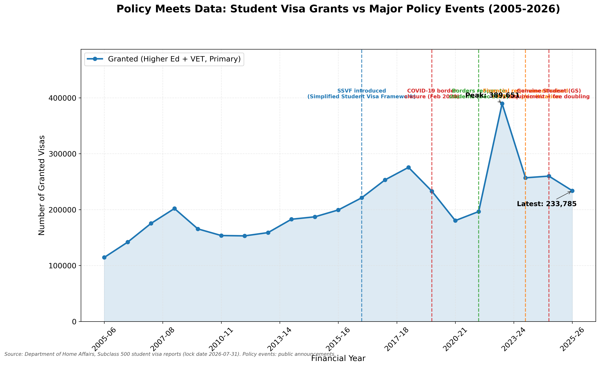
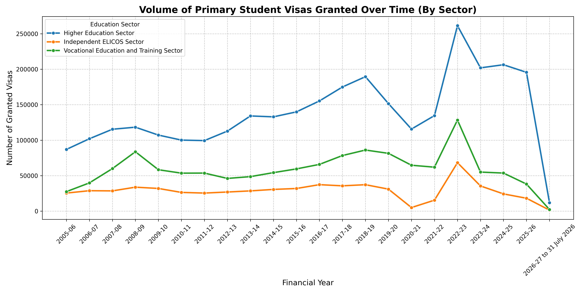
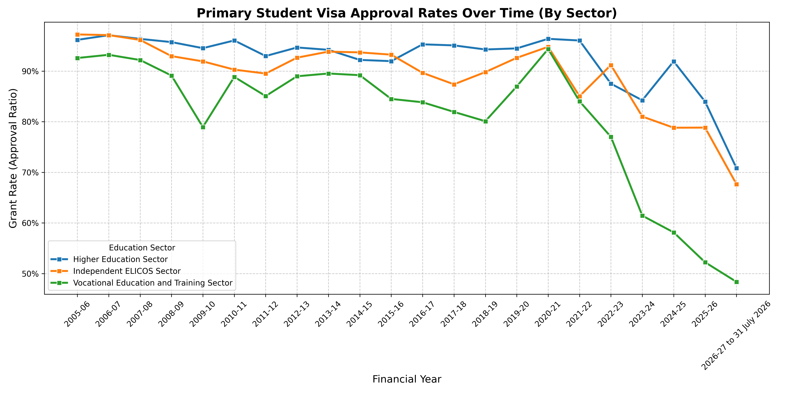
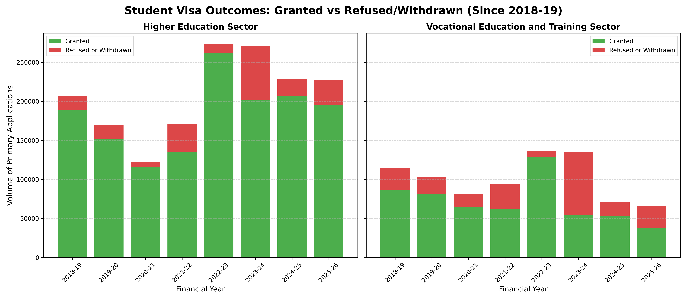
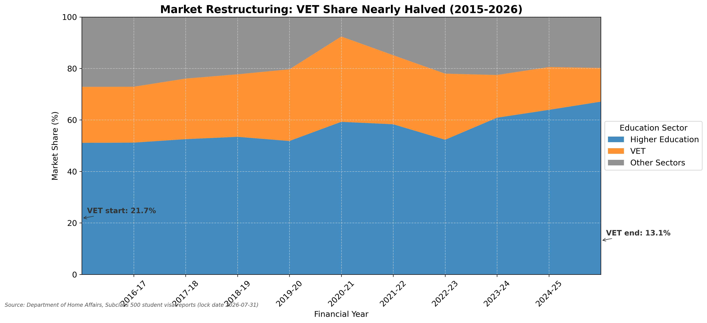

# Australian Student Visa Trends: Policy Shift Analysis (Subclass 500)

## 1. Executive Summary & Context
In recent years, Australian media and political discourse have heavily focused on the influx of international students and the perceived tightening of migration policies. This project analyzes official Department of Home Affairs data across +20 years (2005 to 2026) to empirically evaluate these claims regarding student visa crackdowns.

By processing static Excel pivot tables published by the government, this project aims to uncover the true volume and approval rate trends of Subclass 500 Primary Student Visas across major education sectors.

## 2. Key Findings & Data Insights

### The Post-Pandemic Boom (2018-19 to 2022-23)
Following the reopening of international borders, Australia experienced an unprecedented surge in student visa grants:
- **Higher Education Sector:** Experienced a robust volume growth of **+37.9%** (from 189,477 to a peak of 261,317).
- **Vocational Education and Training (VET) Sector:** Surged even faster at **+49.0%** (from 86,121 to 128,334).

### Targeted Policy Tightening
The data confirms a massive recent policy shift resulting in a severe crackdown on approval rates. However, this crackdown is highly targeted:
- **Higher Education** approval rates dropped by **-16.7 percentage points** (down to 70.8%).
- **VET Sector** suffered a dramatic decline, plummeting by **-28.6 percentage points** (down to a historic low of **48.4%**). This clearly indicates that the government's recent visa tightening is disproportionately focused on the vocational education sector.

## 3. Policy Timeline Analysis
To connect policy decisions with observed outcomes, the analysis overlays major regulatory events on the granted-volume trend (`scripts/policy_timeline.py`):

| Financial Year | Policy Event | Granted (Higher Ed + VET, Primary) |
|---|---|---|
| 2016-17 | SSVF introduced (Simplified Student Visa Framework) | 221,163 |
| 2019-20 | COVID-19 border closure (Feb 2020) | 232,966 |
| 2021-22 | Borders reopen to students (Dec 2021) | 196,582 |
| 2023-24 | Financial requirement raised + MD 107 prioritization | 256,951 |
| 2024-25 | Genuine Student (GS) requirement + fee doubling | 259,971 |



*Reading:* each policy inflection precedes a distinct volume response — the pandemic closure precedes the collapse, reopening precedes the record 2022-23 peak, and the 2023-24/2024-25 tightening measures precede the sharp contraction and VET-specific collapse. Temporal coincidence is noted; causal attribution requires further controls.

## 4. Visualizations

### Visa Grants by Sector


### Grant Rates by Sector


## 5. Socio-Economic Impact & Market Shift

### Massive Surge in Refusals
The tightening of migration policies led to a massive increase in rejected applications. In the 2025-26 financial year alone, the combined number of refused or withdrawn applications across the two major sectors neared **60,000**, with the VET sector experiencing a **+54.8%** surge in refusals compared to the previous year.


### Market Restructuring (Flight to Quality)
The targeted policy crackdowns have caused a severe structural shift in the Australian international education market. The **Vocational Education and Training (VET)** sector has lost nearly half its market share, plummeting from 21.7% to just **13.1%**. Meanwhile, the **Higher Education** sector has aggressively absorbed this space, now dominating the landscape with a **67.1%** market share, cementing itself as the preferred, lower-risk pathway for students.


### The $6.72 Billion Economic Deficit
The abrupt drop in approved visas between the peak (2022-23) and the following year (2023-24) resulted in the loss of **167,921 primary students**. Assuming a conservative annual expenditure of $40,000 AUD per student (tuition and living expenses), this policy shift effectively erased approximately **$6.72 Billion AUD** from the Australian economy in just a single year, heavily impacting the retail, education, and real estate sectors.

## 6. Methodology

- **Source:** Department of Home Affairs Subclass 500 monthly pivot-table reports (Lodged, Granted, Grant Rates), locked at 2026-07-31.
- **Cleaning:** header detection for introductory metadata rows, forward-fill of merged cells, privacy-masked values (`<5`) treated as missing, wide-to-long reshaping via `melt`, and a sequential outer merge into one tidy dataset.
- **Analysis:** sector-level aggregations, year-over-year comparisons, and 100% stacked market-share computation; all figures regenerate from `scripts/clean_data.py` onward.
- All tunable parameters (paths, years, sectors, economic assumptions) live in `config.py`; shared logic in `data_loader.py`; unit tests in `tests/`.

## 7. Limitations

- **Temporal coincidence ≠ causation:** policy events predate volume shifts, but macro conditions (demand abroad, exchange rates, provider behavior) are not controlled for.
- **Privacy-masked data:** government reports suppress small values (`<5`), so very small cells are missing rather than zero.
- **Refusals are derived:** Refused/Withdrawn = Lodged − Granted; month-level processing lag can produce negative estimates that are floored at 0.
- **Partial final year:** FY 2026-27 runs only to 31 July and is excluded from charts.
- **Financial-year approximation:** events are mapped to the FY containing them; intra-year timing is not modeled.

## 8. Reproducibility

- Datasets: `bp0015l-student-visa-{granted,lodged,grant-rates}` reports, lock date **2026-07-31** (place under `data/raw/`).
- Pipeline: `pip install -r requirements.txt` → `python scripts/clean_data.py` → run any analysis script.
- Tests: `python -m pytest tests/ -v`.

## 9. How to Reproduce
Follow these steps to run the pipeline locally:

1. **Clone the repository** and ensure raw government Excel files are in the `data/raw/` directory.
2. **Install dependencies:**
   ```bash
   pip install -r requirements.txt
   ```
3. **Run the Data Cleaning Pipeline:**
   ```bash
   python scripts/clean_data.py
   ```
4. **Run the Trend & Economic Analysis:**
   ```bash
   python scripts/sector_trends_analysis.py
   python scripts/refusals_analysis.py
   python scripts/market_share_analysis.py
   python scripts/economic_impact.py
   python scripts/policy_timeline.py
   ```